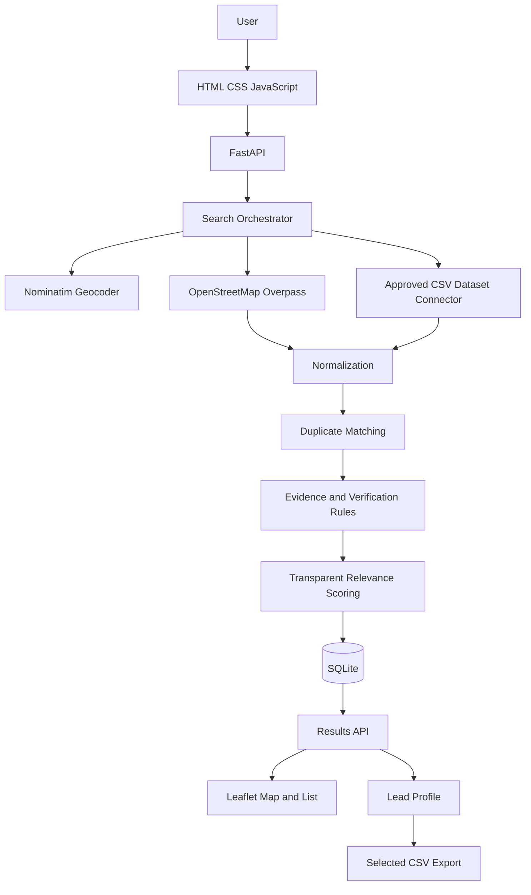

# UNDERSTANDING – Evidence-Based Location-Aware Business Lead Discovery

## 1. Problem and objective
Help sales/marketing teams, small business owners and business development teams discover potential business leads using geography, category and product/service requirements. Collect permitted business information, preserve evidence, qualify leads transparently and export selected records.

## 2. Architecture

## 3. End-to-end flow
1. User submits location, product/service, category, keywords and radius.
2. FastAPI validates input and geocodes the location.
3. Overpass searches OSM for matching tagged objects within the radius.
4. An approved CSV dataset can be imported as an additional independent source.
5. Records are normalized and candidate duplicates are matched by domain or normalized name plus proximity.
6. Each source record is stored as an evidence row; provenance is retained.
7. Verification status is conservative: every record starts `unverified`, and multiple sources are kept as separate evidence rows but never change the status by themselves. `partially_verified`, `verified` and `rejected` require explicit verification evidence on the record (see `determine_verification_status`); no connector supplies it yet, so an approved policy and review workflow are still needed.
8. A preliminary score combines geography, category, keyword overlap and evidence count. The explanation explicitly identifies the heuristic nature of product fit.
9. Business, evidence and search history are stored in SQLite.
10. Frontend displays a Leaflet map, result list and lead profile. User can select leads for CSV export.

## 4. Technology choices
- Python/FastAPI: API and orchestration.
- SQLAlchemy/SQLite: relational storage and evidence history for MVP.
- Nominatim: geocoding; public endpoint policy must be followed.
- Overpass/OSM: open map/business discovery; coverage is incomplete.
- Approved CSV connector: second source path when user has reuse permission; replace or supplement with a task-owner-approved API later.
- Leaflet: map display.
- HTML/CSS/JavaScript: lightweight browser UI.

## 5. Technical risks and tests
| Risk | Mitigation/test |
|---|---|
| Source unavailable or throttled | Timeouts, clear errors, retry/backoff policy and mocked failure tests |
| Terms/rate-limit violation | Source register, attribution, contact User-Agent, caching and compliance review |
| Duplicate records | Unit tests for domain/name/proximity matching and retained provenance |
| Incorrect or conflicting facts | Preserve source-specific evidence and conflict flags; manual review |
| Missing contact information | Keep fields empty; never infer contact details |
| Stale information | Store retrieval timestamps and define freshness thresholds |
| False verification | Conservative statuses; independent evidence and manual acceptance tests |
| Misleading score | Explain components; label product fit as inference, not purchase intent |

## 6. Milestones
- M1: approve sources and compliance requirements.
- M2: search, geocoding, normalization and deduplication.
- M3: evidence storage and approved verification policy.
- M4: relevance scoring and optional AI classification with evidence-grounded output.
- M5: map, list, lead profiles, search history and selected CSV export.
- M6: unit, integration, end-to-end, mobile and documentation validation.

## 7. Design decisions
1. Use OSM/Overpass for initial live discovery; a user-approved CSV source provides a second connector without assuming an unapproved commercial API. Alternative: Google Places; rejected for MVP until API budget and terms are approved.
2. Keep verification conservative; source count alone never marks a record fully verified. Alternative: auto-verify on OSM presence; rejected because existence and current accuracy are not proven.
3. Use transparent heuristic scoring before adding an LLM. Alternative: let AI generate the score; rejected because it is harder to audit and may hallucinate.

## 8. Task-owner decisions still required
- Which second live data provider, if any, is approved and funded?
- Can staff manually correct facts, and should every correction create an audit event?
- Are public registries/open datasets approved, and under what reuse conditions?
- What exact evidence is required for `verified` and `rejected`?
- What should the product/service relevance score mean to sales users?
